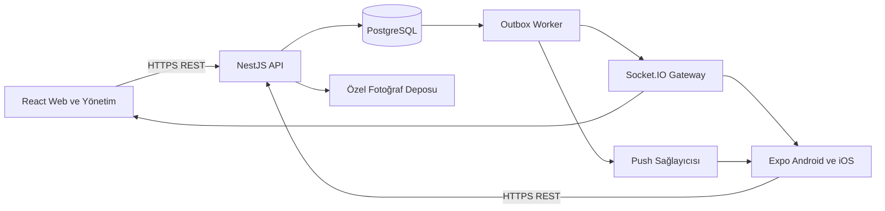

# Hastane İlan Platformu — Mimari Kararlar

Tarih — 10 Kasım 2026

Durum — Tasarım önerisi. Bu belge konuşmada seçilen mimariyi kaydeder. Kapasite rakamları test hedefidir. Uygulama henüz bu belge kapsamında geliştirilmedi veya yük testinden geçirilmedi.

## 1. Amaç ve kapsam

Hastane çalışanlarının ilan yayınladığı, ilanların moderasyondan geçtiği, çalışanların mesajlaştığı ve bildirim aldığı bir platform geliştirilecek. Web ve Android/iOS uygulamaları aynı backend'i kullanacak. Staj kapsamında geliştirilebilir bir başlangıç ve binlerce kullanıcı için ölçülebilir bir büyüme yolu hedefleniyor.

İşlevsel referans, masaüstündeki `Hastane_Ilan_Platformu_Stajyer_Yol_Haritasi.pdf` dosyasıdır. Belgedeki görevler ürün gereksinimi olarak değerlendirildi. Anlık iletişim ve ayrı mobil uygulama kullanıcının ek talepleridir.

İlk mobil sürüm çalışan akışlarını kapsayacak. Yönetim ve moderasyon web üzerinden yürütülecek. Bu kapsam dağılımı mimari öneridir ve kurumun ihtiyacına göre genişletilebilir.

## 2. Teknoloji kararları

| Alan | Seçim | Kullanım amacı |
|---|---|---|
| Mimari | Modüler monolit | İş alanlarını ayrı modüllerde tutup ortak backend olarak geliştirmek ve dağıtmak. |
| Dil | TypeScript | Web, mobil ve backend boyunca tip güvenli geliştirme yapmak. |
| Çalışma ortamı | Node.js LTS | API ve worker süreçlerini çalıştırmak. Başlangıç tercihi Node.js 24 LTS, kurulumda bağımlılık uyumluluğu doğrulanacak. |
| Web | React + Vite | Çalışan uygulamasını ve yönetim panelini geliştirmek. |
| Web tasarımı | Tailwind CSS + Radix UI | Özgün görsel dil ve erişilebilir etkileşim bileşenleri oluşturmak. |
| Mobil | React Native + Expo + Expo Router | Android/iOS uygulamalarını ve bildirimden ekrana geçişleri geliştirmek. |
| Backend | NestJS + Fastify | HTTP API, doğrulama, yetki kontrolleri ve iş kurallarını çalıştırmak. |
| Veritabanı | PostgreSQL | İlişkisel veriyi, işlem tutarlılığını ve kalıcı geçmişi yönetmek. |
| ORM | Drizzle ORM + Drizzle Kit | TypeScript şemaları ve SQL'e yakın tipli sorgularla veri erişimini, transaction ve migration yönetimini sağlamak. |
| API sözleşmesi | REST + OpenAPI | Web ve mobil için sürümlenebilir ortak sözleşme ve üretilen TypeScript istemcisi sağlamak. |
| İstemci sunucu verisi | TanStack Query | Sorgu önbelleği, yüklenme, hata, yeniden deneme ve güncellemeleri yönetmek. |
| Anlık iletişim | Socket.IO | Açık uygulamalara yeni mesaj ve durum olayları iletmek. |
| Mobil bildirim | Expo Notifications + FCM/APNs | Arka plandaki uygulamalar için push almak ve ilgili ekrana yönlendirmek. |
| Push gönderim servisi | Kurum onayıyla Expo Push Service | İlk pilotta sunucudan push gönderimini kolaylaştırmak. Gerekirse doğrudan FCM/APNs entegrasyonu yapılabilir. |
| Arka plan işlemleri | PostgreSQL Outbox + Worker | Bildirim ve e-posta işlerini kalıcı kaydetmek ve tekrar denemek. |
| Fotoğraf deposu | Özel S3 uyumlu nesne deposu | Görselleri veritabanından ayrı saklamak. |
| Çoklu sunucu iletişimi | Redis + Socket.IO Redis Streams adapter | Birden fazla API/gateway instance'ında olayları dağıtmak. |
| Dağıtım | Docker + CI/CD | Tekrarlanabilir kurulum ve kontrollü sürüm yayını sağlamak. |
| Doğrulama | Playwright + k6 + backend entegrasyon testleri | Web akışlarını, işlem kurallarını ve yük altındaki davranışı doğrulamak. |

Paket sürümleri uygulama kurulurken birbiriyle uyumlu kararlı sürümlerden seçilip lockfile ile sabitlenecek. Fastify kullanılan backend'de middleware ve yükleme eklentilerinin Fastify uyumluluğu doğrulanacak.

## 3. Bileşenler ve iletişim



- Kalıcı kayıt oluşturma ve değiştirme işlemleri REST üzerinden yapılacak.
- Socket.IO, ilgili kaydın değiştiğini bildiren küçük olaylar taşıyacak. Ekranlar gerekli güncel veriyi API üzerinden alacak.
- Mesaj geçmişi, bildirim kutusu ve okunmamış sayacı PostgreSQL'den yeniden üretilebilecek.
- Bağlantı geri geldiğinde ve mobil uygulama öne geçtiğinde ilgili veriler yeniden senkronize edilecek.
- API `/v1` altında sunulacak. Eski mobil uygulamalar dikkate alınarak geriye uyumlu değişiklikler yapılacak.
- Tarihler sunucuda UTC saklanacak, arayüzde uygun saat diliminde gösterilecek. Para alanları kesin ondalık değer ve para birimiyle taşınacak.
- API hataları kararlı hata kodu, kullanıcıya uygun mesaj, gerektiğinde alan hataları ve izleme kimliği içerecek.

## 4. Backend modülleri

| Modül | Sorumluluk |
|---|---|
| Identity | Kayıt, hesap onayı, oturumlar, roller, askıya alma ve hesap talepleri. |
| Catalog | Kategori ağacı, kategoriye özel alanlar ve aktiflik kuralları. |
| Listings | Taslak, ilan düzenleme, yayın durumları, fotoğraf ilişkileri, arama ve favoriler. |
| Moderation | İlan onayı/ret/kaldırma, şikâyetler ve karar geçmişi. |
| Messaging | Konuşmalar, mesajlar, okundu bilgisi ve kullanıcı engelleme. |
| Notifications | Bildirim kutusu, tercihler, cihaz token'ları ve kanal teslimatları. |
| Media | Yükleme doğrulaması, görsel işleme ve yetkili görüntüleme. |
| Reporting | Yönetim sayaçları ve tarih aralığı raporları. |
| Audit | Yönetim işlemlerinin yapan kişi, zaman, hedef ve gerekçe bilgileri. |

Controller ve gateway taşıma katmanları olacak. İş kuralları uygulama servislerinde uygulanacak. Modüller birbirlerinin kayıtlarını kontrolsüz değiştirmeyecek. Ortak iş akışı gerektiğinde aynı PostgreSQL transaction'ı kullanılacak.

## 5. Depo ve kod paylaşımı

```text
apps/
  api/
  web/
  mobile/
packages/
  api-client/
  event-contracts/
  design-tokens/
```

API istemcisi, olay sözleşmeleri ve renk/boşluk/tipografi kararları paylaşılacak. Web ve mobil ekranları platformun etkileşimlerine göre geliştirilecek. İş kurallarının yetkili uygulaması backend'de kalacak. TypeScript tiplerine ek olarak bütün dış girdiler çalışma zamanında doğrulanacak.

Worker başlangıçta API dağıtımının parçası olabilir. Fotoğraf işleme veya kuyruk yükü API gecikmesini etkilediğinde aynı kod tabanından ayrı süreç olarak dağıtılacak.

## 6. Veri modeli ve tutarlılık

Temel kayıtlar kullanıcı, oturum, kategori, kategori alanı, ilan, ilan görseli, ilan durum geçmişi, favori, konuşma, mesaj, engel, şikâyet, bildirim, cihaz, bildirim teslimatı, outbox ve denetim kaydıdır.

- Favoride kullanıcı ve ilan çifti benzersiz olacak.
- Aynı ilan ve aynı iki katılımcı için tek konuşma oluşturulacak.
- Mesajlarda konuşma, gönderen ve `clientMessageId` birleşimi benzersiz olacak.
- Aynı kullanıcının aynı ilan için açık şikâyet tekrarları veritabanında engellenecek.
- İlan durum değişiklikleri beklenen durum veya sürüm numarası üzerinden atomik uygulanacak.
- İlan kapatma, hesap askısı, engelleme ve mesaj gönderme arasındaki yarışlar ortak kilitleme veya uygun transaction kurallarıyla çözülecek.
- Son aktif yöneticinin korunması eşzamanlı iki yönetim isteğinde de geçerli olacak.
- Kategoriye özel alanlar sunucuda kategori tanımına göre doğrulanacak. Tanım değişikliklerinin eski ilanlara etkisi açıkça yönetilecek.
- Listeleme sorgularına uygun indeksler kurulacak, büyük listelerde kararlı cursor sayfalama kullanılacak.
- Arama PostgreSQL ile başlayacak. İhtiyaca göre `pg_trgm` kullanılacak ve Türkçe karakter davranışı test edilecek.
- Drizzle sorguları gerektiğinde parametreli SQL ile tamamlanacak. Outbox kilitleme sorguları ve özel indeksler kod incelemesinde açıkça doğrulanacak.

ORM kararı Drizzle olarak güncellendi. Önceki Prisma tercihi genel sorgu ve migration kolaylığına dayanıyordu. Bu projede PostgreSQL'e özgü indeksler, koşullu güncellemeler ve outbox kilitleme sorguları önemli olduğu için SQL'e yakın veri erişimini tercih ediyoruz. Drizzle seçimi bir performans garantisi değildir. Sorgu planları ve transaction davranışı testlerle doğrulanacak. Bu seçim stajyerin temel SQL, indeks ve transaction kavramlarını öğrenmesini gerektirir. Drizzle Kit'in ürettiği migration SQL'i incelenecek ve canlı ortama kontrollü uygulanacak.

## 7. Mesaj, bildirim ve tekrar deneme akışı

1. İstemci mesaj isteği için bir `clientMessageId` oluşturur ve ağ hatasında aynı kimliği kullanır.
2. Backend aktif hesap, konuşma üyeliği, ilan durumu ve engel kurallarını doğrular.
3. Mesaj, uygulama içi bildirim ve outbox kaydı aynı transaction'da yazılır.
4. Başarı yanıtı veritabanı commit'inden sonra döner.
5. Worker olayı alır, bağlı kullanıcıya anlık güncelleme iletir ve uygun kanallarda bildirim gönderir.
6. İstemci bağlantı kesintisi sonrasında API üzerinden eksikleri tamamlar.

Outbox işleri küçük partiler halinde alınacak. Birden fazla worker gerektiğinde `FOR UPDATE SKIP LOCKED` ve süreli iş sahipliği kullanılacak. Worker çöktüğünde süresi geçen işler yeniden alınabilecek. Geçici hatalar artan bekleme süreleriyle tekrar denenecek, sürekli başarısız işler inceleme için saklanacak.

Bildirim teslimatları kanal ve cihaz bazında izlenecek. Harici sağlayıcıya gönderim ile yerel sonuç kaydı arasındaki kesinti tekrar gönderime yol açabilir. Tüketiciler olay kimliğiyle tekrarları tolere edecek. Uygulama içi bildirimlerin tekilliği veritabanında korunacak.

Mobil push genel bir metin taşıyacak. Özel mesaj içeriği ve ret gerekçesi kilit ekranına gönderilmeyecek. Bildirime dokunulduğunda hedefe erişim yeniden doğrulanacak. Geçersiz cihaz token'ları devre dışı bırakılacak, çıkışta cihaz-hesap ilişkisi kaldırılacak.

## 8. Yetkilendirme ve medya erişimi

Yetkilendirme rol, kaynak ilişkisi ve güncel durum birlikte değerlendirilerek yapılacak. İlan sahipliği, konuşmaya üyelik ve moderatör yetkisi her ilgili işlemde denetlenecek. Socket odalarına katılım sunucuda yetkilendirilecek.

Kurumun uygun SSO sistemi varsa entegrasyon tercih edilecek. Uygulama içi hesap onayı ve izinler backend'de kalacak. SSO bulunmadığında kılavuzdaki kayıt, parola ve manuel onay akışı uygulanacak. Kimlik sağlayıcısı kurum bilgisi olmadan kesinleştirilmedi.

Web oturumu güvenli, HttpOnly çerezle ve gerekli CSRF korumasıyla yönetilecek. Mobil OAuth/OIDC akışında sistem tarayıcısı ve Authorization Code + PKCE kullanılacak. Hassas oturum bilgileri Expo SecureStore'da tutulacak.

Askıya alınan hesabın açık oturumla işlem yapması engellenecek. Güncel hesap ve oturum durumu sunucuda doğrulanacak. İlgili soketler kapatılacak ve bekleyen teslimatlarda alıcının durumu tekrar değerlendirilecek.

Fotoğraflar özel depoda tutulacak. İlk sürümde görüntüleme, her istekte erişim kontrolü yapan API üzerinden sağlanacak. Böylece kaldırılan ilanın eski görsel adresine yapılan yeni istekler reddedilebilecek. İstemci ve ara önbellek politikaları bu kuralla uyumlu olacak. Daha önce indirilmiş veya ekran görüntüsü alınmış içeriğin geri alınması mümkün değildir.

Yüklemede dosyanın gerçek içeriği, türü, boyutu, adedi ve görüntü boyutları doğrulanacak. Güvenli yeniden kodlama ile küçük görseller üretilecek, gereksiz EXIF bilgileri temizlenecek. İşlenmemiş dosya yayına açılmayacak.

## 9. Ürün deneyimi ve işlem kalitesi

Tasarım hedefi, özgün görsel dili ve tutarlı davranışları olan bir çalışan uygulamasıdır. Hazır bir tema seçiminden önce tipografi, renk, boşluk, görsel oranları ve etkileşim durumları tanımlanacak.

- Favori gibi geri alınabilir işlemler anlık görsel geri bildirim verecek, hata halinde önceki durum geri yüklenecek.
- Mesaj açıkça gönderiliyor, gönderildi veya tekrar dene durumunu gösterecek.
- Yayınlama, moderasyon ve hesap işlemlerinde başarı sunucu sonucuna bağlı gösterilecek.
- İlan taslağı kaydedilebilecek, form hataları alanın yanında gösterilecek, yanlışlıkla ayrılmada veri kaybı önlenecek.
- Liste konumu ve filtreler detaydan dönüşte korunacak.
- Yükleniyor, boş, hata ve erişim kaldırıldı durumları bütün temel ekranlarda tasarlanacak.
- Mobilde klavye, güvenli ekran alanları, geri hareketi, fotoğraf seçimi ve bildirimden açılma gerçek cihazlarda doğrulanacak.
- Ekran okuyucu, klavye erişimi, kontrast ve azaltılmış hareket tercihleri dikkate alınacak.
- Hassas mesajların cihazda kalıcı önbelleğe alınması ayrıca değerlendirilip çıkış ve hesap değişiminde yerel veriler temizlenecek.

## 10. Kapasite, ölçekleme ve gözlemleme

Aşağıdaki değerler başlangıç yük testi hedefidir. Ölçülmüş sistem kapasitesi veya sağlayıcı garantisi değildir.

| Senaryo | Hedef |
|---|---|
| 3.000 açık soket, 100 API isteği/sn, 20 mesaj/sn | Başarılı API çağrılarında p95 350 ms altı; commit'ten bağlı alıcı güncellemesine p95 2 saniye altı. |
| 5.000 sokete kademeli çıkış ve kısa süreli iki kat API trafiği | İlk darboğazı ve sürdürülebilir kaynak sınırlarını ölçmek. |
| Toplu yeniden bağlanma | Rastgele gecikmeli tekrar bağlantı ve doğru veri senkronizasyonu sağlamak. |
| Push sağlayıcısı kesintisi | Ana işlemler ve bildirim kutusu çalışırken gönderimleri biriktirip yeniden denemek. |

CPU, bellek, event-loop gecikmesi, DB bağlantı havuzu, yavaş sorgular, hata oranı, soket sayısı, outbox yaşı ve teslimat hataları izlenecek. Loglarda istek/olay kimliği kullanılacak, parola ve token gibi bilgiler maskelenecek. İzleme sağlayıcısı barındırma kararıyla birlikte seçilecek.

Pilot bir API/gateway instance'ıyla başlayabilir. Yük testi veya erişilebilirlik gereksinimi çoklu instance gerektirdiğinde yük dengeleyici ve Redis Streams adapter eklenecek. HTTP long-polling açıksa sticky session kurulacak. Yalnız WebSocket kullanımı kurum ağı ve mobil bağlantılarda doğrulanmadan varsayılmayacak.

Veritabanı ve nesne deposu yedekleri boş ortama geri yüklenerek sınanacak. Canlı ortamın yedeklilik seviyesi, kabul edilen veri kaybı ve geri dönüş süresi kurumla belirlenecek.

## 11. Geliştirme ve teslim sırası

1. Ortak API, giriş, web'de ilan oluşturma/onaylama ve mobilde ilan görüntülemeyi uçtan uca çalıştır.
2. Kategori, fotoğraf, arama, favori, şikâyet ve moderasyon akışlarını tamamla.
3. Kalıcı mesajlaşma, engelleme, okundu bilgisi ve bildirim kutusunu tamamla.
4. Socket.IO, bağlantı sonrası senkronizasyon ve gerçek cihaz push akışını ekle.
5. Yetki, eşzamanlılık, kesinti, yük ve yedekten dönüş testlerini tamamla.
6. Kurulum, veri modeli, API sözleşmesi, test sonuçları ve işletim adımlarını teslim et.

Mobil geliştirme baştan başlayacak. Platform kimlik bilgileri, development build ve deep link doğrulaması son aşamaya bırakılmayacak.

## 12. Kurum bilgisiyle kesinleşecek kararlar

- Staj süresi, ekip büyüklüğü ve TypeScript deneyimi.
- Tek hastane veya birden fazla kurum kapsamı. İlk tasarım tek kurum varsayımıyla hazırlanmıştır.
- Kimlik sağlayıcısı ve çalışan doğrulama yöntemi.
- Barındırma yeri, sağlayıcı, veri bölgesi ve aylık bütçe.
- Gerçek eşzamanlı kullanım, trafik dağılımı ve erişilebilirlik hedefleri.
- Bildirim sağlayıcısı, veri işleme/aktarım değerlendirmesi ve kurumun saklama süreleri.
- Android/iOS dağıtım yöntemi ve mağaza hesapları.
- Mobilde yönetim ekranlarına ihtiyaç olup olmadığı.

## 13. Teknik kaynaklar

- [NestJS Fastify adaptörü](https://docs.nestjs.com/techniques/performance)
- [NestJS OpenAPI](https://docs.nestjs.com/openapi/introduction)
- [Node.js sürümleri](https://nodejs.org/en/about/previous-releases)
- [Drizzle transaction belgeleri](https://orm.drizzle.team/docs/transactions)
- [PostgreSQL kısıtlar](https://www.postgresql.org/docs/current/ddl-constraints.html)
- [PostgreSQL SELECT ve SKIP LOCKED](https://www.postgresql.org/docs/current/sql-select.html)
- [Transactional outbox](https://docs.aws.amazon.com/prescriptive-guidance/latest/cloud-design-patterns/transactional-outbox.html)
- [Socket.IO teslim garantileri](https://socket.io/docs/v4/delivery-guarantees/)
- [Socket.IO çoklu sunucu](https://socket.io/docs/v4/using-multiple-nodes/)
- [Socket.IO Redis Streams adapter](https://socket.io/docs/v4/redis-streams-adapter/)
- [Expo Router](https://docs.expo.dev/router/introduction/)
- [Expo push kurulumu](https://docs.expo.dev/push-notifications/push-notifications-setup/)
- [Expo push gönderimi](https://docs.expo.dev/push-notifications/sending-notifications/)
- [Expo SecureStore](https://docs.expo.dev/versions/latest/sdk/securestore/)
- [TanStack Query optimistic updates](https://tanstack.com/query/latest/docs/framework/react/guides/optimistic-updates)
- [Radix erişilebilirlik](https://www.radix-ui.com/primitives/docs/overview/accessibility)
- [OAuth native uygulama rehberi](https://www.rfc-editor.org/info/rfc8252/)
- [S3 imzalı URL davranışı](https://docs.aws.amazon.com/AmazonS3/latest/userguide/using-presigned-url.html)

Kaynaklar görüşme sırasında incelenmiştir. Kütüphane API'leri ve sağlayıcı limitleri uygulama kurulurken yeniden doğrulanmalıdır.
